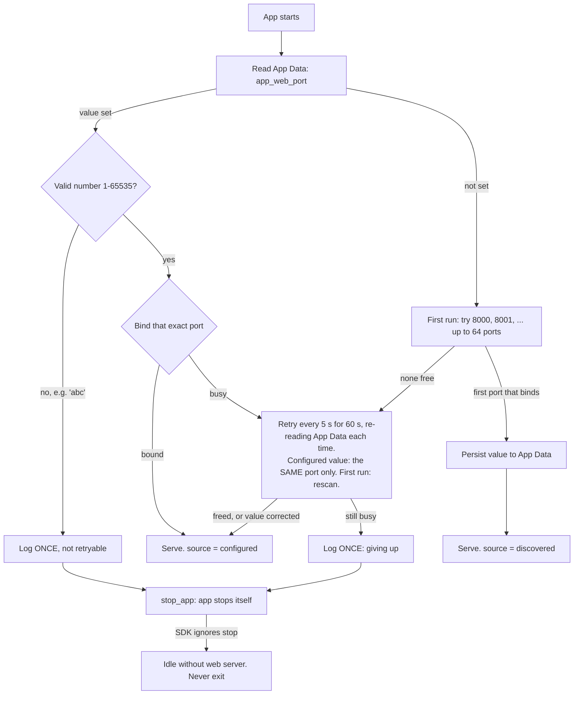

# How Dynamic Web Ports works

## The problem

SDK web apps traditionally hardcode a port (usually 8000). That breaks in
three ways:

1. **Collisions.** Two web apps on one router both want 8000. The second one
   fails to start.
2. **Fleet changes need a rebuild.** To move an app to another port on a group
   of routers you have to edit code, repackage, and redeploy.
3. **Pinned connections break.** An NCM LAN Manager connection or a firewall
   rule that points at a specific port stops working if the app quietly moves.

## The idea

The port lives in **Application Data** (SDK Data in NCM), not in the code.

```
<app_name>_web_port        e.g. speedtest_analyzer_web_port = 8000
                                sdwan_analyzer_web_port     = 8001
```

- If an admin set the value, the app uses **exactly** that port.
- If nobody did, the app finds a free port on its first run, saves it, and
  reuses it from then on.

No code change and no new package is needed to move an app to another port. Set
the value in NCM (Group or Device SDK Data) and restart the app.

## The shared module

Everything is in one file, `src/web_port.py`: standard library only, no `cp`
import. The caller passes in `cp.get_appdata`, `cp.put_appdata` and `cp.log`.
That makes it identical in every app, like `cp.py`, and testable without a
router (35 unit tests ship with the kit).

| Function | Purpose |
|---|---|
| `bind_web_socket_with_retry(app, get, put, log, **kw)` | **Use this at startup.** Resolve and bind the port, retrying a busy port briefly. |
| `bind_web_socket(app, get, put, log, **kw)` | Single attempt. Used by the retry wrapper. |
| `stop_app(put, log)` | Ask the SDK to stop this app (final failure). |
| `appdata_field(app)` | The field name: `<app>_web_port`. |
| `parse_port(raw)` | Validate a configured value. |
| `read_app_uuid()` | App uuid from `package.ini` (used by `stop_app`). |

`PortResult` fields: `ok`, `port`, `sock`, `source` (`configured` or
`discovered`), `persisted`, `error`, `retryable`.

## Resolution flow



### Rules that never bend

- **A configured value is authoritative.** The app never scans for another
  port, never relocates, and never overwrites the value.
- **A bad value fails closed.** A typo cannot silently move a pinned port.
- **Discovery only writes a port it actually bound.** This is recording an
  assignment, not writing a default into App Data.

## Failure handling: why the app stops itself

SDK apps run with `restart = true`. If an app **exits**, NCOS restarts it a few
seconds later. A permanently bad port value therefore causes a restart loop that
floods the router log (observed on the first iteration of this work: a restart
every 3 to 5 seconds, indefinitely).

Leaving the process running with no web server is also wrong. It reports
"Started" while serving nothing, which is confusing and hides the problem.

So on a final failure the app **stops itself through the SDK**:

```
PUT control/system/sdk/action   "stop <app uuid>"      (uuid read from package.ini)
```

A stopped app is not restarted by the restart policy. The reason is logged once.
The admin fixes the value and starts the app again. `auto_start` will also try
again after a router reboot, which costs one log cycle per boot, not a loop.

| Situation | Behavior | Log lines |
|---|---|---|
| Value is `abc` or out of range | No waiting. App stops. | 2 |
| Value is a valid port but busy | Retry same port about 60 s, then app stops. | 4 |
| First run and 8000-8063 all busy | Same as busy port. | 4 |
| SDK ignores the stop request | App idles without the web server. Still no exit. | +1 |

Repeated identical log lines during the retry window are collapsed, so a busy
port produces a handful of lines rather than one per attempt.

## No check-then-bind race

The helper returns an **already-bound, listening socket**. The caller gives that
exact socket to `HTTPServer(..., bind_and_activate=False)`. The successful bind
is the availability test, so nothing can take the port between "is it free?" and
"bind it".

Because `bind_and_activate=False` skips `server_bind()`, the caller must also
(a) close the unused placeholder socket that `HTTPServer.__init__` creates, and
(b) set `server_name` and `server_port` if the handler uses them. See
`examples/retrofit_custom_server_class.py`.

## Design decisions

| Decision | Why |
|---|---|
| Separate `web_port.py`, not inlined | Same precedent as `cp.py`. One reviewed implementation, identical in every app, testable on its own. Inlined copies drift. |
| Copy per app, not a shared library | Each app stays self-contained for upload to NCM and for upstream contribution. |
| App Data, not a config file | App Data survives upgrades and reboots and NCM can set it at Group or Device level without credentials. |
| Namespaced `<app>_web_port` | Device-level App Data is shared by all apps. A generic `web_port` would collide. |
| Fail closed on a configured value | Protects NCM LAN Manager connections and firewall rules pinned to a port. |
| Retry the same port only | Covers a port briefly held during a redeploy without ever relocating. |
| Stop the app, don't exit | Avoids the restart loop and the "started but serving nothing" state. |
| Discovery bounded to 64 ports | Deterministic and fast. 8000 to 8063. |
| Persist the discovered port | The URL stays the same across reboots even if 8000 later frees up. |

## NCM usage

Set a field named `<app_name>_web_port` in **SDK Data** on a Group or a Device.
The app reads it on its next start. No NCM API credentials are involved.

- Set it at **Group** level to put a whole fleet on one port.
- Set it at **Device** level to override one router.
- Two apps pinned to the same port: the second fails closed and stops. Give each
  app its own value.
- To go back to automatic selection, delete the field and restart the app. It
  rediscovers a port.

## Limits worth knowing

- **IPv4 only.** It binds `0.0.0.0`.
- **App Data changes apply on the next app start.** The port is not re-read while
  the app runs.
- **`cp.start_file_server()`** in the SDK `cp.py` defaults to port 8000 and is
  not covered by this standard.
- **A persisted discovered port is sticky.** If an app discovered 8001 because
  8000 was busy, it stays on 8001 until the value is deleted or changed.
- **LAN clients need a firewall rule.** See `TROUBLESHOOTING.md`.
